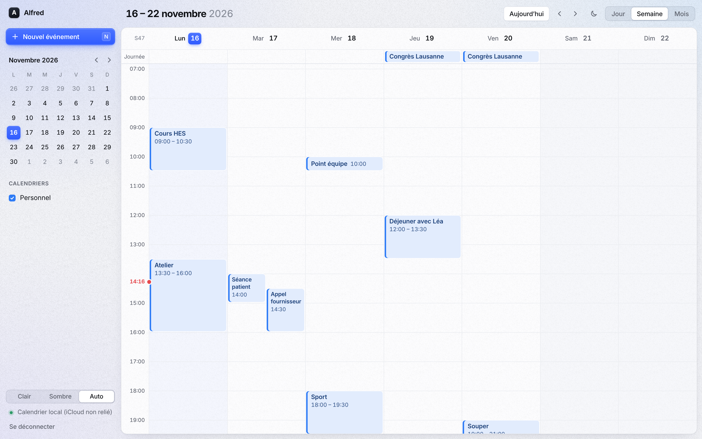
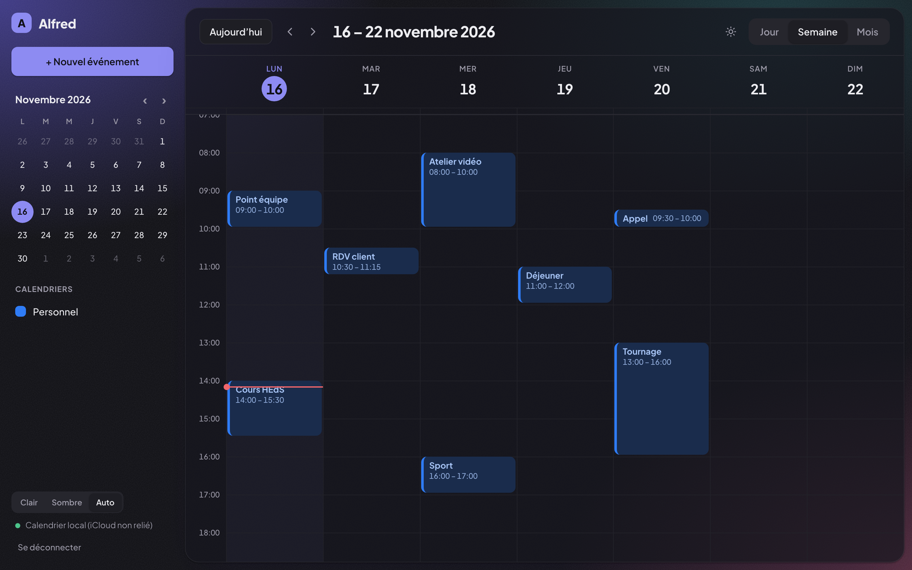
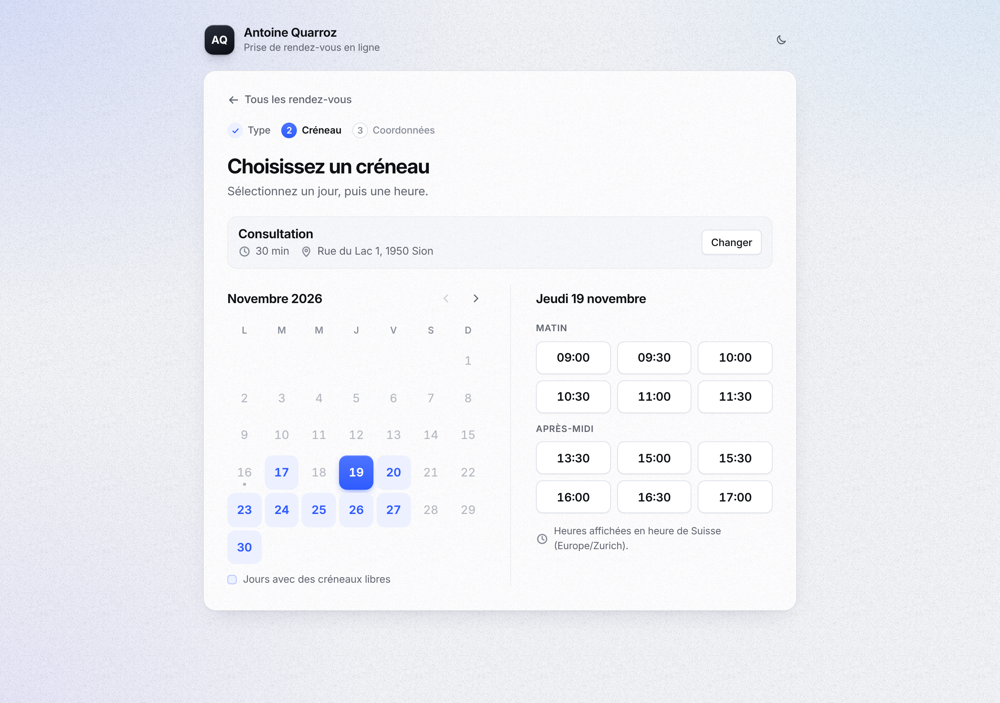
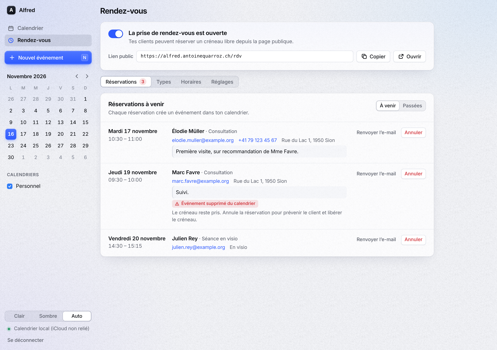

# Alfred

Assistant personnel tout-en-un, auto-hébergé sur VPS. Premier chantier : **le calendrier**.





## Où on en est

| Étape | Contenu | État |
|---|---|---|
| **v1 : mon calendrier** | Vues jour, semaine et mois, création, modification, suppression, événements récurrents, synchro iCloud dans les deux sens, app installable (PWA) | ✅ Développé, à déployer |
| v1.1 : prise de RDV | Page publique, types de RDV, créneaux calculés sur les vrais événements, e-mails de confirmation | Développée : page publique `/rdv`, rubrique « Rendez-vous » dans l'app |
| v2 : visio intégrée | Salles LiveKit liées aux événements (après agrandissement du VPS) | À venir |
| Ensuite | Apps Mac (Tauri) et mobile (Capacitor), agent IA | À venir |

## Ce que fait la v1

- **Calendrier complet** : jour, semaine, mois, mini-calendrier, plusieurs calendriers avec leurs couleurs, thème clair, sombre ou automatique.
- **Édition rapide** : clic ou glisser dans la grille pour créer, glisser-déposer pour déplacer, poignée pour changer la durée, journées entières, répétitions.
- **Événements récurrents** : affichage fidèle (exceptions, heure d'été), modification ou suppression « seulement cet événement » ou « toute la série ».
- **Synchro iCloud dans les deux sens** (CalDAV) : les calendriers restent dans iCloud. Ce qui est fait dans Alfred part tout de suite dans iCloud, ce qui est fait sur l'iPhone ou le Mac arrive dans Alfred en 2 minutes au plus.
- **Installable** sur Mac (Safari > Ajouter au Dock) et iPhone (Partager > Sur l'écran d'accueil).
- **Léger** : un seul conteneur, environ 110 Mo de RAM, base SQLite dans un fichier.

Raccourcis : `n` nouvel événement, `t` aujourd'hui, `j` jour, `s` semaine, `m` mois, `←` `→` naviguer.

## La prise de rendez-vous (v1.1)



- **Page publique** `/rdv` : le client choisit un type de rendez-vous, un jour dans le calendrier (les jours sans créneau sont grisés), une heure, puis laisse ses coordonnées. Les créneaux sont calculés sur les vrais événements, en heure de Suisse.
- **Réservation** : l'événement est créé dans le calendrier (donc dans iCloud), le client reçoit un e-mail de confirmation avec un fichier pour son agenda et un lien d'annulation.
- **Rubrique « Rendez-vous »** dans l'app : ouvrir ou fermer la prise de rendez-vous, copier le lien public, gérer les types, les horaires hebdomadaires, les calendriers qui bloquent, voir et annuler les réservations, vérifier l'envoi d'e-mails.
- **Fermée par défaut** : rien n'est réservable tant que l'interrupteur n'est pas activé.
- **Agenda vivant** : si tu déplaces un rendez-vous dans Apple Calendar, la réservation suit (l'ancien créneau se libère) et l'app te rappelle de prévenir le client ; les journées entières (congés) bloquent toute la journée.
- **À sauvegarder** : les réservations, types et horaires ne vivent que dans la base d'Alfred, pas dans iCloud (voir [Déploiement](docs/DEPLOIEMENT.md)).



## Démarrer en local

```bash
npm install
npm run dev        # serveur sur :3200, app web sur http://localhost:5173
```

Sans configuration, Alfred démarre avec un calendrier local et le mot de passe `alfred` (mode dev uniquement). Pour relier iCloud, ouvrir **Réglages** dans l'app, ou copier `.env.example` en `.env` et le remplir.

```bash
npm test           # tests (la synchro CalDAV est testée contre un vrai serveur si RADICALE_URL est défini)
npm run build && npm start
```

## Documentation

- [Architecture](docs/ARCHITECTURE.md) : comment c'est construit et comment la suite (RDV, visio) s'y branche
- [API de la prise de rendez-vous](docs/API-RDV.md) : routes, formes JSON et codes d'erreur
- [Déploiement sur le VPS](docs/DEPLOIEMENT.md) : pas à pas, avec le mot de passe d'application iCloud
- [Audit de faisabilité](docs/AUDIT.md) : l'étude de départ
