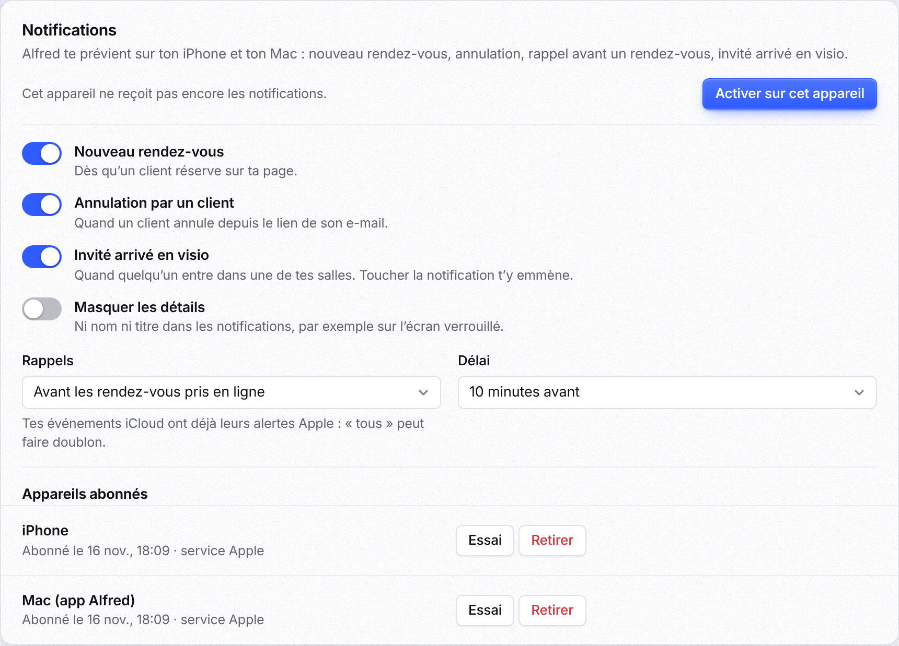

# Alfred sur Mac et iPhone

## En bref

Alfred s'installe **comme une app** sur l'iPhone et le Mac, avec ses propres **notifications**, sans App Store
et sans compte développeur Apple. C'est la même app web, installée depuis Safari ; elle se met à jour toute
seule à chaque déploiement sur le VPS.

| | iPhone / iPad | Mac |
|---|---|---|
| Installer | Safari → Partager → **Sur l'écran d'accueil** | Safari → Fichier → **Ajouter au Dock** (macOS 14 Sonoma ou plus) |
| Version minimale pour les notifications | iOS / iPadOS **16.4** | Safari 16 (macOS 13) ; Chrome et Edge aussi |
| Activer les notifications | Ouvrir Alfred depuis son icône → Réglages → Notifications → **Activer sur cet appareil** | Pareil, dans l'app du Dock (ou dans Safari / Chrome) |
| Coût | 0 | 0 |

## Ce qu'Alfred notifie

- **Nouveau rendez-vous** pris sur la page publique (nom, type, jour et heure).
- **Annulation par un client** depuis le lien de son e-mail.
- **Rappel** 5 à 60 minutes avant un rendez-vous pris en ligne (ou, au choix, avant tout événement à heure fixe).
  Si le rendez-vous est en visio, toucher la notification ouvre directement la salle.
- **Invité arrivé en visio** : toucher la notification fait entrer dans la salle.
- Un réglage **Masquer les détails** retire noms et titres (écran verrouillé).

Tout se règle dans l'app : Réglages → Notifications. La liste montre chaque appareil abonné, son dernier envoi
réussi ou sa dernière erreur, avec un bouton **Essai**.

## Comment ça marche

C'est le standard **Web Push** (le même pour Safari, Chrome, Firefox et Edge) :

1. À l'installation, Alfred crée une paire de clés **VAPID** (dans la base, table `push_settings`).
2. L'appareil s'abonne auprès du service de push de son fabricant (Apple, Google, Mozilla) avec la clé publique,
   et Alfred enregistre l'abonnement (`push_subscriptions`).
3. Pour notifier, Alfred chiffre le message pour cet appareil (RFC 8291) et l'envoie au service de push, signé
   avec sa clé privée (RFC 8292). Apple ou Google ne voient pas le contenu.
4. Le service worker (`web/public/sw.js`) affiche la notification et ouvre la bonne page au toucher.

Le code est dans `server/push/` (sans dépendance ajoutée : `node:crypto` suffit) ; la carte est
`web/src/settings/NotificationsCard.tsx`. Les rendez-vous sont relus toutes les 30 secondes dans la table
`bookings` : la prise de RDV ne dépend pas du push, et une notification n'est pas perdue si l'envoi échoue au moment
de la réservation. Alfred n'envoie qu'aux services de push connus (Apple, Google, Mozilla, Microsoft) ;
un appareil désabonné (réponse 404/410) est retiré tout seul.

**Déploiement** : rien à configurer, pas de variable d'environnement, pas de port à ouvrir. Le VPS doit pouvoir
sortir en HTTPS vers `*.push.apple.com` (c'est le cas par défaut).

**Sauvegarde** : la paire de clés VAPID est dans `alfred.db`. Si la base est perdue, il suffit de réactiver les
notifications sur chaque appareil.

## Les limites, et quand passer au natif

Ce que l'app installée **ne fait pas** :

- pas de pastille de compteur ni de widget sur l'écran d'accueil, pas de Siri ni de raccourcis ;
- sur iPhone, les notifications n'existent que si Alfred est installé sur l'écran d'accueil (règle d'Apple) ;
- pas d'appel entrant « plein écran » façon FaceTime (CallKit) pour la visio ;
- pas de présence dans l'App Store.

Si un de ces points devient nécessaire, l'étape suivante est d'**emballer la même app** plutôt que de tout
réécrire :

| Option | Pour quoi | Compte Apple Developer (99 USD par an) |
|---|---|---|
| **Capacitor** (iPhone) | App Store / TestFlight, notifications natives (APNs), pastille, widgets plus tard | **Oui**, obligatoire pour installer sur un iPhone au-delà de 7 jours et pour les notifications natives |
| **Tauri** (Mac, ~10 Mo) | App Mac signée, icône dans la barre des menus, démarrage à l'ouverture de session | Non pour l'usage perso (app non signée, à autoriser une fois dans Réglages Système) ; **oui** pour la distribuer signée et notariée, ou pour les notifications natives APNs |
| SwiftUI natif | Expérience 100 % Apple | **Oui**, et une app à maintenir en plus de l'app web |

Recommandation : rester sur l'app installée tant qu'elle suffit ; si l'App Store ou CallKit deviennent utiles,
Capacitor réutilise tout le code actuel et ajoute seulement l'abonnement APNs côté serveur.
